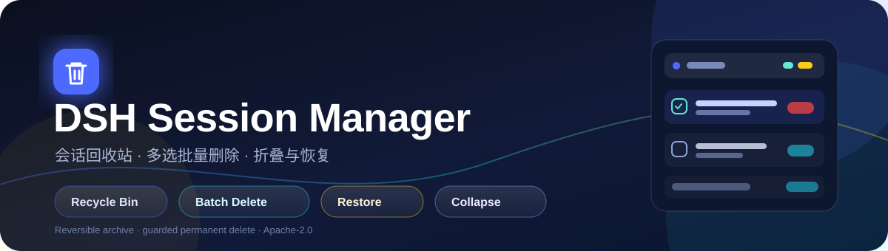
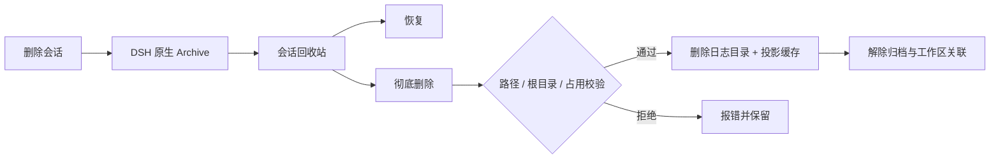
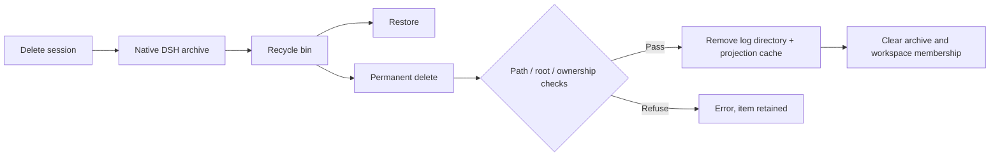

<p align="center">
  
</p>

<p align="center">
  <a href="https://github.com/dsh-pluggin-free/session-manager/stargazers">
    
  </a>
  <a href="LICENSE">
    
  </a>
  <a href="https://github.com/dsh-pluggin-free/session-manager/actions/workflows/test.yml">
    
  </a>
  <a href="https://github.com/dsh-pluggin-free/session-manager/releases">
    
  </a>
  
  
</p>

<p align="center">
  <a href="#zh"><strong>中文</strong></a> · <a href="#english">English</a>
</p>

<a id="zh"></a>

# 会话管理器 · DSH Session Manager

> **删得安心，找得回来，清得干净。**  
> 给 DeepSeek Harness 的左侧会话栏加上回收站、多选批量删除、会话折叠与安全彻底清理。

如果你经常在 DSH 里积累几十上百个会话，原生侧栏的「归档」很快就不够用了：归档会话混在筛选里、批量整理很麻烦、想彻底释放磁盘又怕误删。

**会话管理器**把这件事做成了一套顺手的侧栏工作流：删除先进回收站，随时恢复；确认不要了，再批量彻底删除。所有操作都在本机完成，不上传任何会话内容。

---

## ✨ 为什么值得装

- **删除不再心慌**：普通删除只是移入回收站，日志仍在本机，随时恢复。
- **批量整理很快**：在会话列表和回收站里都能多选，批量归档 / 批量彻底删除。
- **侧栏更清爽**：会话列表可以一键折叠；回收站向下展开，自动让出空间。
- **彻底删除有护栏**：只删除确认属于该会话的日志目录，校验路径、会话根目录和内存占用。
- **开箱即用**：一个 GitHub 安装命令，无额外运行时依赖。

---

## 🚀 功能亮点

| 功能 | 说明 |
| --- | --- |
| 🗑️ 会话回收站 | 侧栏底部独立区域，默认折叠；展开后从标题行向下铺开，内容占满剩余高度并内部滚动；归档后的会话行会从会话列表隐藏，即使原生筛选开着“显示已归档” |
| ✅ 选择模式 | 标题栏搜索按钮左侧的勾选按钮进入；空闲会话行左侧出现圆框，勾选后显示对号 |
| 🧺 批量归档 | 选中多个会话，一键移入回收站；运行中的会话会先停止当前工作 |
| 🧹 回收站多选 | 回收站每行左侧勾选框，支持全选 / 取消全选 |
| 💥 批量彻底删除 | 「彻底删除所选」二次确认后批量物理删除，成功 / 失败数量如实提示 |
| ♻️ 恢复 | 回收站单条恢复，回到原工作区 |
| 📉 会话折叠 | 标题文字后的折叠按钮，只隐藏会话列表，保留标题、搜索和操作行 |
| 🧭 旧数据迁移 | 首次启用时自动导入旧版 `sessions-manager-trash` 的删除记录，迁移只执行一次 |
| 🔒 本地优先 | 不联网、不上传；只在 Host 本机操作 DSH 会话数据 |

---

## 🖼️ 界面一览

> 文字示意，实际界面随 DSH 主题自动适配。

```text
┌─ 会话 ─────────────────────────  ⌄   ☑   🔍 ─┐
│   ●  会话 A                                  │
│   ●  会话 B                                  │
│   ●  会话 C                                  │
│                                              │
├─ 会话回收站 16 ──────────────────────────────┤
│   ☑  会话 D                     [恢复] [彻底删除] │
│   ☐  会话 E                     [恢复] [彻底删除] │
│   [全选]              已选 1 个        [彻底删除所选] │
└─ Settings ───────────────────────────────────┘
```

- `⌄`：折叠 / 展开会话列表
- `☑`：进入 / 退出选择模式
- `🔍`：DSH 原生搜索
- 回收站展开时，上方会话列表自动折叠；Settings / Cordis 保持可见

---

## 📦 安装

### 方式一：GitHub 直装（推荐）

```bash
dsh plugin --profile desktop add "github:dsh-pluggin-free/session-manager"
```

如果你同时使用 Web profile：

```bash
dsh plugin --profile web add "github:dsh-pluggin-free/session-manager"
```

安装完成后重启 DSH，或刷新 Web 页面。侧栏底部出现「会话回收站」即安装成功。

### 方式二：本地 link（开发调试）

```bash
git clone https://github.com/dsh-pluggin-free/session-manager.git
cd session-manager
dsh plugin --profile desktop add "link:$PWD"
```

Windows PowerShell：

```powershell
git clone https://github.com/dsh-pluggin-free/session-manager.git
cd session-manager
dsh plugin --profile desktop add "link:$PWD"
```

### 更新

```bash
dsh plugin --profile desktop add "github:dsh-pluggin-free/session-manager"
```

重新执行安装命令会拉取最新版本；也可以先移除再安装。

### 卸载

```bash
dsh plugin --profile desktop remove dsh-session-manager
```

---

## 🧭 使用指南

### 1. 删除会话

- 在会话列表多选后点「删除」，或在会话行菜单里归档。
- 删除只会把会话移入回收站（DSH 原生归档），**不会立刻从磁盘消失**。
- 归档后的会话会立即从会话列表隐藏（即使原生视图开着“显示已归档”），只出现在回收站里。
- 运行中的会话会先停止当前工作，再归档。

### 2. 从回收站恢复

- 展开「会话回收站」，在目标会话行点「恢复」。
- 会话会回到原工作区，日志保持完整。

### 3. 彻底删除

- 单条：回收站行「彻底删除」→ 二次确认。
- 批量：勾选多条 →「彻底删除所选」→ 二次确认。
- 彻底删除会移除该会话的本地日志目录与投影缓存，**不可恢复**。
- 部分失败时会提示成功 / 失败数量，失败项仍保留勾选，方便重试。

### 4. 折叠会话列表

- 点「会话 / 工作区」文字后的折叠按钮，只隐藏列表，保留标题栏。
- 展开搜索时会自动恢复列表，避免搜索结果被折叠。
- 打开回收站时会自动折叠列表；关闭回收站后恢复原来的折叠状态。

---

## 🛡️ 数据安全

- **软删除 = DSH 原生归档**：日志不移动、不删除，归档状态可撤销。
- **彻底删除前做多层校验**：
  - 日志路径必须属于该会话（目录名 = 会话 ID，或历史扁平布局中文件名包含完整 ID）；
  - 路径必须位于 `$DSH_HOME/sessions` 内；
  - 会话不能在内存中仍被安全占用；无法安全移除时拒绝并提示。
- **只清理该会话自己的文件**：会话日志目录 + `session_projcache` 对应记录；不会删除项目目录或其他会话。
- **不直接改 `workspace.json`**：归档、恢复、工作区关联都通过 DSH 官方服务完成。
- **本地运行**：插件不发起任何网络上传，不读取与回收站无关的会话内容。

> ⚠️ 彻底删除不可撤销。第一次使用建议先拿一个不重要的会话试一遍。

---

## 🔧 工作原理



- Host 半：`/session-recycle/*` JSON 路由、旧回收站迁移、路径守卫、物理删除。
- Client 半：侧栏标题栏控制、会话回收站、选择模式、批量操作、确认框。
- 数据仍由 DSH 原生 Session / Workspace 服务持有；插件只通过公开能力读写。

---

## 📁 项目结构

```text
.
├── index.js             Host 半：路由、迁移、彻底删除与安全校验
├── client.js            Web 半：侧栏 UI、标题栏控制、回收站
├── path-guard.js        会话日志路径归属校验
├── cordis.patch.yml     DSH profile 插件行
├── locale/              中英文界面文案
├── icon.svg             插件图标
├── assets/banner.svg    README 横幅
├── test/                路径、删除、SSR 与布局测试
└── README.md
```

---

## 🧪 开发与测试

```bash
npm install
npm test
```

测试覆盖：

- 路径守卫：目录布局 / 扁平布局 / 子串碰撞 / 根目录边界
- 隔离临时根目录中的真实目录删除、投影缓存清理、解归档与 workspace detach
- 客户端组件 SSR 渲染
- 客户端多选 / 批量归档 / 批量彻底删除状态流转
- 标题栏按钮注入、会话折叠、回收站向下展开与样式恢复（jsdom）

---

## ❓ FAQ

**删除会话会立刻释放磁盘吗？**  
不会。普通删除只是移入回收站；只有「彻底删除」才会移除本地日志。

**为什么左侧圆框只出现在部分会话行？**  
这是 DSH 官方行插槽的挂载规则：左侧 16px 席位只在会话主状态为「空闲」时渲染；运行中 / 等待确认的会话由状态圆点占用该位置。选择模式仍可正常使用，批量操作只针对可见会话。

**会破坏 DSH 的数据吗？**  
不会直接修改 `workspace.json`。所有归档 / 恢复都走 DSH 服务；物理删除前会校验路径归属、会话根目录和内存占用。

**旧版 sessions-manager 删除的会话怎么办？**  
首次启用时会读取 `$DSH_HOME/sessions-manager-trash/index.json`，把其中的删除记录导入原生归档集合，只执行一次。之后可以在新回收站里恢复或彻底删除。

**需要联网吗？**  
不需要。插件只在本机读写 DSH 会话数据。

**支持哪些平台？**  
Windows / macOS / Linux 上只要能运行 DSH 即可；主要在 Windows + DSH 0.2.2-rc.1 实测。

---

## ⭐ 支持这个项目

如果这个插件帮你省下了整理会话的时间，点一个 **Star** 就是最好的支持。  
也欢迎提交 Issue 或 PR：更快的批量清理、更多筛选维度、跨后端适配都值得做。

<p align="center">
  <a href="https://github.com/dsh-pluggin-free/session-manager/stargazers">
    
  </a>
</p>

---

<a id="english"></a>

# Session Manager for DeepSeek Harness

> **Delete safely. Restore instantly. Clean permanently.**  
> A recycle bin, multi-select batch delete, collapsible session list, and guarded permanent cleanup for the DSH sidebar.

<p align="center">
  <a href="#zh">中文</a> · <a href="#english"><strong>English</strong></a>
</p>

If you use DeepSeek Harness every day, your sidebar eventually fills up with sessions. Native archive is safe, but it is not a workflow: archived rows hide in a filter, batch cleanup is tedious, and freeing disk space without deleting the wrong thing is risky.

**Session Manager** turns that into a simple sidebar flow: deleted sessions go to a recycle bin, can be restored at any time, and can be permanently removed in batches only after an explicit confirmation. Everything stays local.

---

## ✨ Why you'll love it

- **Delete without anxiety** — a normal delete only archives the session; its log stays on disk and can be restored.
- **Clean up in batches** — multi-select works in both the active session list and the recycle bin.
- **A calmer sidebar** — collapse the session list; open the recycle bin and it expands downward while the list makes room.
- **Guarded permanent delete** — validates that the log path belongs to the session, lives under the session root, and is not held in memory.
- **Install in one command** — no extra runtime dependencies.

---

## 🚀 Features

| Feature | What it does |
| --- | --- |
| 🗑️ Recycle bin | A collapsible section at the sidebar bottom; expands downward and fills the available height with its own scroll; archived rows disappear from the session list even when the native filter shows archived rows |
| ✅ Selection mode | A checkbox button left of the search button; idle session rows show a circle that becomes a checkmark |
| 🧺 Batch archive | Select multiple sessions and move them to the recycle bin; running sessions are stopped first |
| 🧹 Recycle-bin multi-select | A checkbox on every trash row, with Select all / Clear selection |
| 💥 Batch permanent delete | "Delete selected" asks for confirmation, then physically deletes the selected logs and reports success / failure counts |
| ♻️ Restore | Restore one trash item to its original workspace |
| 📉 Collapse sessions | A collapse button after the section title hides only the list, keeping the header and search row |
| 🧭 Legacy trash import | On first run, imports the old `sessions-manager-trash` deletion records into the native archive set; one time only |
| 🔒 Local-first | No upload, no network calls; only the local DSH session data is touched |

---

## 🖼️ At a glance

> Text sketch only; the real UI follows the active DSH theme.

```text
┌─ Sessions ───────────────────────  ⌄   ☑   🔍 ─┐
│   ●  Session A                                 │
│   ●  Session B                                 │
│   ●  Session C                                 │
│                                                 │
├─ Recycle bin 16 ────────────────────────────────┤
│   ☑  Session D                    [Restore] [Delete] │
│   ☐  Session E                    [Restore] [Delete] │
│   [Select all]          1 selected       [Delete selected] │
└─ Settings ──────────────────────────────────────┘
```

- `⌄` — collapse / expand the session list
- `☑` — enter / leave selection mode
- `🔍` — native DSH search
- Opening the recycle bin collapses the session list; Settings / Cordis stay visible

---

## 📦 Installation

### GitHub install (recommended)

```bash
dsh plugin --profile desktop add "github:dsh-pluggin-free/session-manager"
```

For a Web profile as well:

```bash
dsh plugin --profile web add "github:dsh-pluggin-free/session-manager"
```

Restart DSH or refresh the Web page. The "Recycle bin" row at the sidebar bottom means it is installed.

### Local link (development)

```bash
git clone https://github.com/dsh-pluggin-free/session-manager.git
cd session-manager
dsh plugin --profile desktop add "link:$PWD"
```

Windows PowerShell:

```powershell
git clone https://github.com/dsh-pluggin-free/session-manager.git
cd session-manager
dsh plugin --profile desktop add "link:$PWD"
```

### Update

```bash
dsh plugin --profile desktop add "github:dsh-pluggin-free/session-manager"
```

Re-running the install command pulls the latest version. You can also remove and re-add the plugin.

### Uninstall

```bash
dsh plugin --profile desktop remove dsh-session-manager
```

---

## 🧭 How to use

### Delete a session

- Select sessions and click **Delete**, or use the session row menu's archive action.
- The session goes to the recycle bin (native DSH archive); the log is **not** removed from disk yet.
- Archived rows disappear from the session list immediately (even when the native view shows archived sessions); they only appear in the recycle bin.
- Running sessions are stopped before being archived.

### Restore from the recycle bin

- Open **Recycle bin**, click **Restore** on a row.
- The session returns to its original workspace with its complete log.

### Permanently delete

- Single: **Delete** on a trash row → confirm.
- Batch: check multiple rows → **Delete selected** → confirm.
- This removes the session's local log directory and projection-cache record. **It cannot be undone.**
- On partial failure, the result shows how many were removed and how many failed; failed rows stay selected for retry.

### Collapse the session list

- Click the collapse button after the "Sessions / Workspaces" title. Only the list is hidden; the header and search stay.
- Expanding search automatically restores the list so search results remain visible.
- Opening the recycle bin collapses the list automatically; closing it restores the previous collapse state.

---

## 🛡️ Data safety

- **Soft delete = native DSH archive.** The log is not moved or removed; the archive state is reversible.
- **Permanent delete checks, in order:**
  - the log path belongs to this session (session directory name equals the session ID, or a legacy flat file name contains the complete ID);
  - the path is inside `$DSH_HOME/sessions`;
  - the session is not still safely held in memory; if it cannot be safely detached, deletion is refused.
- **Only the session's own files are removed:** its log directory and the matching `session_projcache` record. Project directories and other sessions are never removed.
- **`workspace.json` is not edited directly.** Archive, restore and workspace membership go through the official DSH services.
- **Local only.** No network upload and no reading of unrelated session content.

> ⚠️ Permanent deletion is irreversible. Try it on a disposable session first.

---

## 🔧 How it works



- Host half: `/session-recycle/*` JSON routes, legacy trash migration, path guards, permanent deletion.
- Client half: header controls, recycle bin, selection mode, batch actions, confirmation dialog.
- Session and workspace data remain owned by the native DSH services.

---

## 📁 Project layout

```text
.
├── index.js            Host: routes, migration, permanent delete, safety guards
├── client.js           Web: sidebar UI, header controls, recycle bin
├── path-guard.js       Session log path ownership checks
├── cordis.patch.yml    DSH profile plugin row
├── locale/             Chinese / English UI strings
├── icon.svg            Plugin icon
├── assets/banner.svg   README banner
├── test/               Path, delete, SSR and layout tests
└── README.md
```

---

## 🧪 Development and tests

```bash
npm install
npm test
```

Coverage:

- Path guards: directory layout / flat layout / substring collisions / root boundary
- Real deletion in an isolated temporary root: log directory, projection cache, unarchive, workspace detach
- Client component SSR rendering
- Client multi-select / batch archive / batch permanent delete state transitions
- Header button injection, session collapse, downward recycle-bin layout and style restoration (jsdom)

---

## ❓ FAQ

**Does deleting a session free disk space immediately?**  
No. A normal delete only moves it to the recycle bin; **Delete permanently** removes the local log.

**Why does the left circle only appear on some rows?**  
That is the official DSH row-slot rule: the 16px leading seat only renders when the row's primary state is idle. Running / waiting rows use the status dot in that seat. Selection mode still works for the visible rows.

**Can it corrupt DSH data?**  
It never edits `workspace.json` directly. Archive and restore use the native services; permanent deletion validates the path, session root and in-memory state first.

**What about sessions deleted by the old sessions-manager?**  
On first run it reads `$DSH_HOME/sessions-manager-trash/index.json`, imports those records into the native archive set, and does this only once. They can then be restored or permanently removed here.

**Does it need network access?**  
No. It only reads and writes local DSH session data.

**Which platforms are supported?**  
Windows, macOS and Linux wherever DSH runs. Primary testing: Windows with DSH 0.2.2-rc.1.

---

## ⭐ Support the project

If this plugin saves you time, a **Star** is the best way to support it.  
Issues and PRs are welcome — faster bulk cleanup, more filters, and additional backend support are all good directions.

<p align="center">
  <a href="https://github.com/dsh-pluggin-free/session-manager/stargazers">
    
  </a>
</p>
